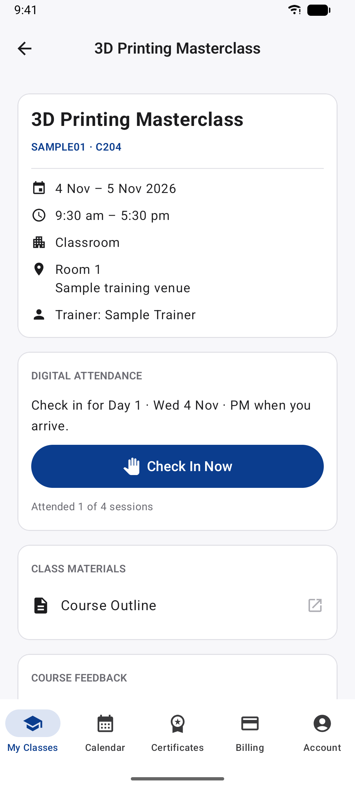
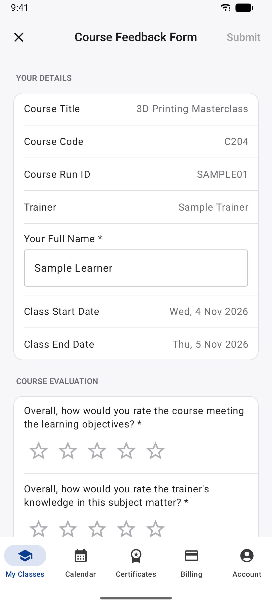
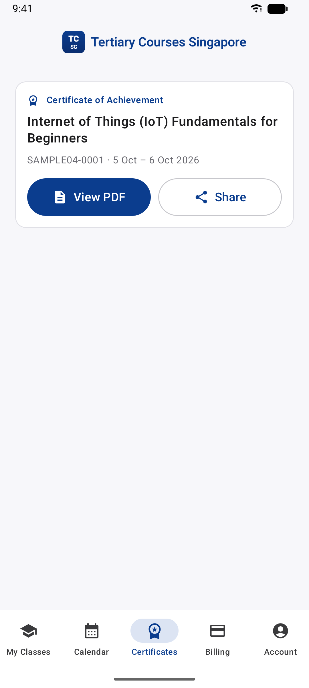
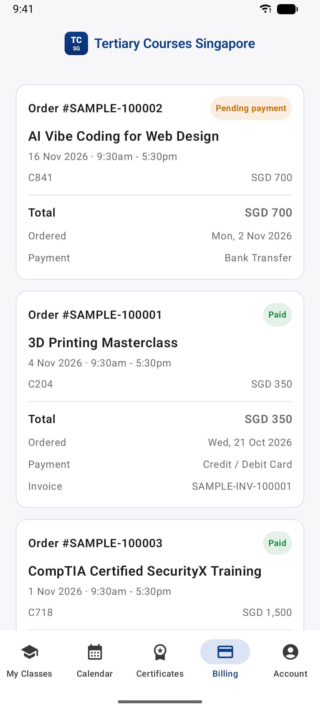

# TC LMS SG — Android App


[](https://play.google.com/store/apps/details?id=com.tertiaryinfotech.tertiarycoursesapp)

**TC LMS SG** is the app for learners and trainers of
[Tertiary Courses Singapore](https://www.tertiarycourses.com.sg/). Learners sign in with the email
they registered with on the website to see their non-WSQ classes, check in, open class materials, give
course feedback, and get their certificates and billing records. Trainers sign in with their trainer
account to see the classes they teach (WSQ and non-WSQ), take attendance and open the courseware.
Anyone can browse the public course catalog. It is the Android counterpart of the iOS app of the same name, with the same
features and the deep-blue (`#0B3D8E`) house design in light and dark.

<p><a href="https://play.google.com/store/apps/details?id=com.tertiaryinfotech.tertiarycoursesapp"></a></p>

## Features

**Signed out** — bottom navigation: Sign In · Courses · About
- **Sign In** — emailed 6-digit code or website password.
- **Courses** — the site's non-WSQ catalog: search, category filter, collapsible category sections,
  course detail with *View Schedule & Register* and *Enquire via WhatsApp*. Works offline from a
  cached copy or the bundled snapshot.

**Signed in** — bottom navigation: My Classes · Calendar · Certificates · Billing · Account
- **My Classes** — Current / Upcoming / Past, reloaded when the app returns to the foreground. A
  trainer sees the classes they teach and attend together, tagged **Teaching** / **Attending**.
- **Class detail (learner)** — **Check In Now** (digital attendance), class materials, **Give
  Feedback** (the site's survey with 1–5 star ratings), certificate and per-session attendance.
- **Class detail (trainer)** — **Take Attendance** (session picker, roster with present switches,
  Save, present count), **Show Check-in QR**, trainer and learner courseware, feedback response count.
- **In-app documents** — materials, documents and certificates open inside the app: PDFs are drawn
  with `PdfRenderer` (pinch / double-tap to zoom), Google Drive and web pages in a WebView; Share and
  Open in Browser in the title bar.
- **Calendar** — month grid with class-day dots and the day's classes; *Add My Classes to Calendar*
  opens the calendar app's new-event screen for each class (no calendar permission needed).
- **Class reminders** — local notifications 3 days before a class (09:00), the evening before each
  class day (18:00) and one hour before the start (08:00 if the class has no time), in the site's
  time zone. Scheduled on the device with inexact alarms; no push service.
- **Certificates** — View PDF / Share.
- **Billing** — orders with items, totals, payment method and invoices.
- **Account** — Edit Profile (name, phone), Appearance (System / Light / Dark, saved to the account),
  Class reminders switch, Browse Courses, website, Send Feedback (WhatsApp), About, Privacy Policy,
  Sign Out, Delete Account.

Permissions: `INTERNET`; `POST_NOTIFICATIONS` (class reminders, asked once after the first class
load on Android 13+); `RECEIVE_BOOT_COMPLETED` (reminders are set again after a restart). No
exact-alarm, calendar, storage or location permission.

## Screenshots

| My Classes | Class Detail | Feedback | Calendar |
|---|---|---|---|
|  |  |  |  |

| Certificates | Billing | Courses | Sign In |
|---|---|---|---|
|  |  |  |  |

## One codebase, three countries

`app/src/main/java/com/tertiaryinfotech/tertiarycourses/Site.kt` is the **only per-country source
file**: app name, site name, API base URL, contacts, WhatsApp number, currency, time zone, price note
and academy name. The TC LMS MY and TC LMS GH apps use the same sources with their own `Site.kt`,
`applicationId`, `app_name` and launcher icon. Nothing else may hard-code a country.

## Backend

JSON API at `https://www.tertiarycourses.com.sg/mobileapi/` (`MMD_MobileApi` in ai-mms; see
`docs/mobile-learner-api.md` there). Every response is `{"ok":true,...}` or
`{"ok":false,"error":"<message>"}`; the app shows the message. Requests send
`Authorization: Bearer <token>` and an explicit `User-Agent: TCLMS-Android/<version> (SG; <applicationId>)`,
because the site's `.htaccess` rejects some default agents with 403. A 401 on a non-auth call clears
the session and returns to sign-in.

## Tech Stack

- **Kotlin 2.1** + **Jetpack Compose** (Material 3, light and dark colour schemes; the account's saved appearance wins), single activity, one `AppViewModel`
- **OkHttp 4.12** + `org.json` + coroutines — models parsed by hand (no reflection, R8-safe)
- **androidx.security-crypto** `EncryptedSharedPreferences` for the session token
- **ZXing core** for the check-in QR matrix; `PdfRenderer` + WebView for in-app documents;
  `AlarmManager` (inexact) for class reminders
- Min SDK 26 (Android 8.0) · Target/Compile SDK 36 · AGP 8.10 · Gradle 8.13

## Project Structure

```
app/src/main/java/com/tertiaryinfotech/tertiarycourses/
├── Site.kt            # THE per-country file (SG / MY / GH)
├── Api.kt             # OkHttp JSON client, User-Agent, 401 handling, encrypted token store
├── Models.kt          # API models (snake_case JSON → Kotlin) + date/time/money formatting
├── AppViewModel.kt    # Session, roles, LMS data (learner + trainer), profile, theme, catalog, back stacks, debug hooks
├── MainActivity.kt    # Activity, signed-out / signed-in bottom navigation, routing
├── Ui.kt              # Theme (light / dark palette), brand header, cards, buttons, image loader, intents
├── SignInScreen.kt    # Email code / password sign-in
├── ClassesScreens.kt  # My Classes, class detail (check-in, materials, certificate), survey
├── LearnerScreens.kt  # Calendar, Certificates, Billing, Account
├── TrainerScreens.kt  # Trainer class: take attendance, check-in QR, courseware
├── ProfileScreens.kt  # Edit Profile, Appearance, Class reminders switch, notification permission
├── DocumentViewer.kt  # In-app PDF (PdfRenderer) and web (WebView) document viewer
├── Reminders.kt       # Local class reminders (alarms, boot receiver) and device settings
├── CatalogScreens.kt  # Course catalog + course detail
└── SupportScreens.kt  # Feedback (WhatsApp) and About
app/src/main/assets/catalog.json   # offline catalog snapshot
```

Refresh the bundled catalog snapshot:

```bash
curl -s -A "TCLMS-Android/1.0" https://www.tertiarycourses.com.sg/mobileapi/catalog \
  | python3 -c 'import json,sys;d=json.load(sys.stdin);json.dump({"courses":d["courses"]},open("app/src/main/assets/catalog.json","w"))'
```

## Build

```bash
export JAVA_HOME="/Applications/Android Studio.app/Contents/jbr/Contents/Home"
export ANDROID_HOME="$HOME/Library/Android/sdk"
./gradlew :app:assembleDebug        # debug APK
./gradlew :app:bundleRelease        # signed release AAB (needs keystore.properties)
```

Release signing reads `keystore.properties` (never committed):

```properties
storeFile=upload-keystore.jks
storePassword=...
keyAlias=upload
keyPassword=...
```

## Screenshot automation (debug builds only)

```bash
adb shell am start -n com.tertiaryinfotech.tertiarycoursesapp/com.tertiaryinfotech.tertiarycourses.MainActivity \
  --es UITEST_SIGNIN "email|password" --ei START_TAB 0 --ei OPEN_RUN_ID 900001 --ez OPEN_SURVEY true
# also: --es OPEN_BUCKET current|upcoming|past   --es UITEST_THEME light|dark|system   --ez UITEST_SIGNOUT true
```

The App Review account (`appreview@tertiarycourses.com.sg`; password in the gitignored `.env`) returns
sample data: run 900001 current, 900002 upcoming, 900003/900004 past.

## Release Notes

See [CHANGELOG.md](CHANGELOG.md). Current version: **1.4 (3)**.

## Developer

**Tertiary Infotech Academy Pte. Ltd.** — [tertiaryinfotech.com](https://www.tertiaryinfotech.com/) · [tertiarycourses.com.sg](https://www.tertiarycourses.com.sg/) · enquiry@tertiaryinfotech.com · +65 6100 0613 · [Privacy Policy](https://www.tertiaryinfotech.com/privacy)
