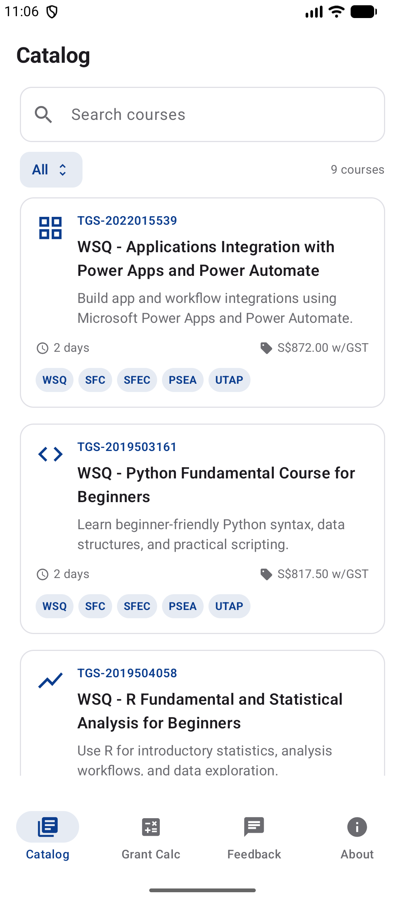
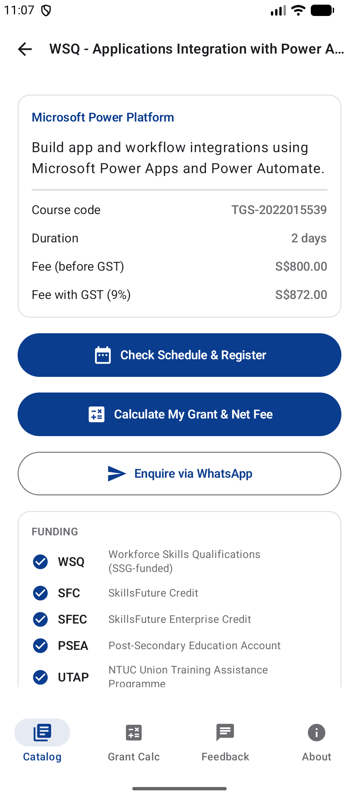
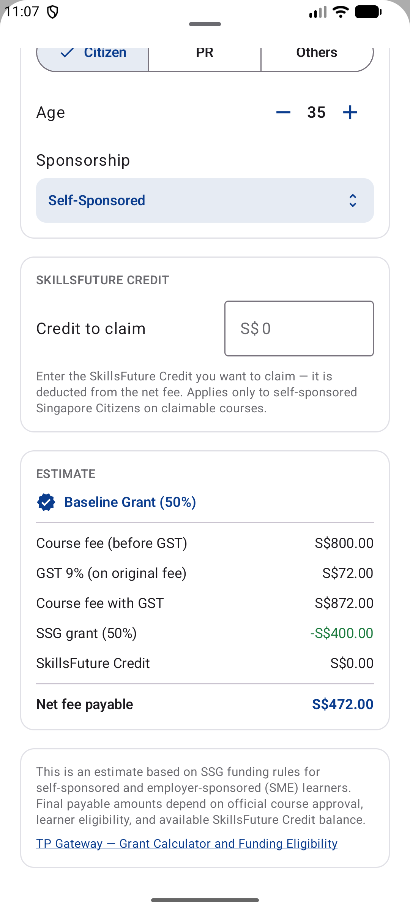
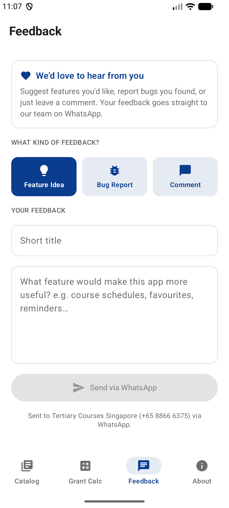
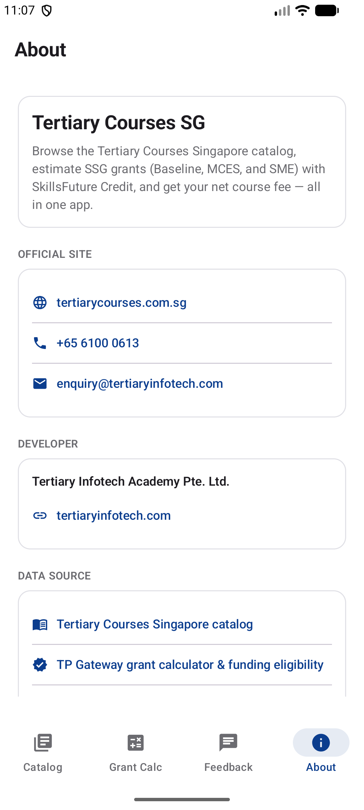

# Tertiary Courses SG — Android App


Native Android app for [Tertiary Courses Singapore](https://www.tertiarycourses.com.sg/) — browse the WSQ course catalog, estimate SSG grants and SkillsFuture Credit, get your net course fee, and register on the website. The Android counterpart of the [iOS app](https://github.com/alfredang/tertiarycoursesapp), with the same features and white/deep-blue house design.

## Features

- **Course Catalog** — search WSQ (Workforce Skills Qualifications) courses by keyword or category. Each card shows the TGS course code, duration, fee with 9% GST, and funding-scheme badges (WSQ, SFC, SFEC, PSEA, UTAP).
- **Course Details** — summary, fees before/with GST, funding-scheme eligibility, learning outcomes, plus:
  - **Check Schedule & Register** — opens the course page on tertiarycourses.com.sg
  - **Calculate My Grant & Net Fee** — grant calculator sheet with the course fee pre-filled
  - **Enquire via WhatsApp** — pre-composed enquiry to +65 8866 6375
- **Grant Calculator** — SSG funding estimate per [TP Gateway rules](https://www.tpgateway.gov.sg/faq/grant-calculator-and-funding-eligibility): Baseline Grant (50%), MCES (70% for Singapore Citizens 40+), SME Enhanced Training Support (70%), with GST computed on the original fee and SkillsFuture Credit deduction for eligible learners.
- **Feedback** — feature ideas, bug reports, and comments sent via WhatsApp.
- **About** — official site, contact links, developer info, and data sources.

## Screenshots

| Catalog | Course Detail | Grant Calculator |
|---|---|---|
|  |  |  |

| Feedback | About |
|---|---|
|  |  |

## Tech Stack

- **Kotlin 2.1** + **Jetpack Compose** (Material 3), single-activity architecture
- **Navigation Compose** for the catalog → course detail flow
- Light-only theme with the Tertiary Infotech deep-blue brand accent `#0B3D8E`
- `BigDecimal` grant math mirroring the iOS `GrantEstimate` model
- Min SDK 26 (Android 8.0) · Target/Compile SDK 36 · AGP 8.10 · Gradle 8.13

## Project Structure

```
app/src/main/java/com/tertiaryinfotech/tertiarycourses/
├── MainActivity.kt      # Theme, bottom navigation, shared UI components
├── Models.kt            # Course model, bundled WSQ catalog, currency formatting
├── CatalogScreens.kt    # Catalog search/filter, course cards, course detail + grant sheet
├── GrantCalculator.kt   # GrantEstimate (SSG rules) + calculator screens
└── SupportScreens.kt    # Feedback (WhatsApp) and About tabs
```

## Build

```bash
export JAVA_HOME="/Applications/Android Studio.app/Contents/jbr/Contents/Home"
./gradlew :app:assembleDebug        # debug APK
./gradlew :app:bundleRelease        # signed release AAB (needs keystore.properties)
```

Release signing reads `keystore.properties` (never committed):

```properties
storeFile=upload-keystore.jks
storePassword=...
keyAlias=upload
keyPassword=...
```

## Release Notes

See [CHANGELOG.md](CHANGELOG.md). Current release: **1.0 (1)** — first closed-testing release on Google Play.

## Data Sources & Disclaimer

Grant estimates are based on SkillsFuture Singapore (SSG) funding rules published on the official [SSG Training Partners Gateway](https://www.tpgateway.gov.sg/faq/grant-calculator-and-funding-eligibility). Check your SkillsFuture Credit balance at [MySkillsFuture](https://www.myskillsfuture.gov.sg/). All figures are estimates; final payable amounts depend on official course approval and learner eligibility. This app is not affiliated with or endorsed by SSG.

## Developer

**Tertiary Infotech Academy Pte. Ltd.** — [tertiaryinfotech.com](https://www.tertiaryinfotech.com/) · [tertiarycourses.com.sg](https://www.tertiarycourses.com.sg/) · enquiry@tertiaryinfotech.com · +65 6100 0613
