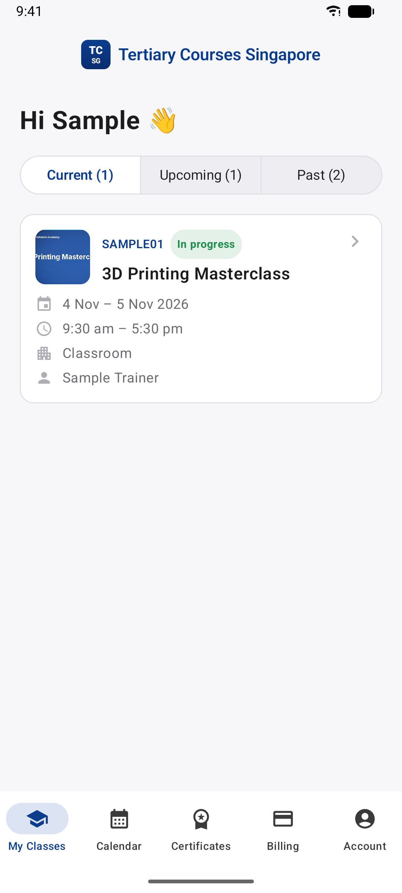
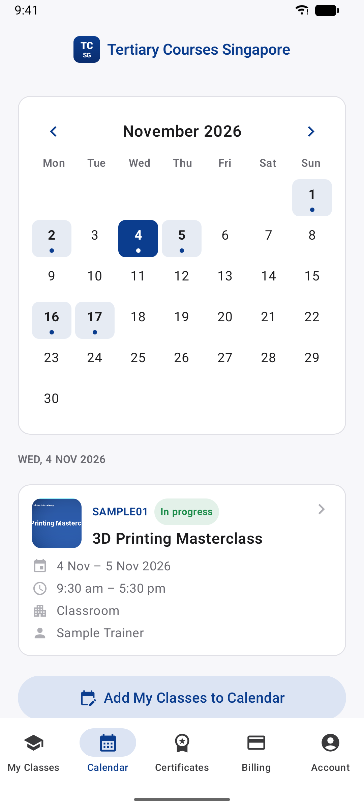
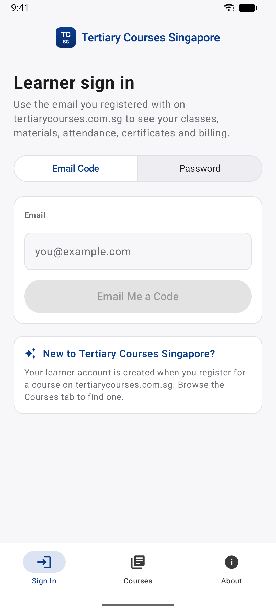

# TC LMS SG — Android App


[](https://play.google.com/store/apps/details?id=com.tertiaryinfotech.tertiarycoursesapp)

**TC LMS SG** is the learner app for the non-WSQ courses of
[Tertiary Courses Singapore](https://www.tertiarycourses.com.sg/). Learners sign in with the email
they registered with on the website to see their classes, check in, open class materials, give
course feedback, and get their certificates and billing records. Anyone can browse the public
course catalog. It is the Android counterpart of the iOS app of the same name, with the same
features and the white / deep-blue (`#0B3D8E`) house design.

## Features

**Signed out** — bottom navigation: Sign In · Courses · About
- **Sign In** — emailed 6-digit code or website password.
- **Courses** — the site's non-WSQ catalog: search, category filter, collapsible category sections,
  course detail with *View Schedule & Register* and *Enquire via WhatsApp*. Works offline from a
  cached copy or the bundled snapshot.

**Signed in** — bottom navigation: My Classes · Calendar · Certificates · Billing · Account
- **My Classes** — Current / Upcoming / Past, with class detail: **Check In Now** (digital
  attendance), class materials, **Give Feedback** (the site's survey with 1–5 star ratings),
  certificate and per-session attendance.
- **Calendar** — month grid with class-day dots and the day's classes; *Add My Classes to Calendar*
  opens the calendar app's new-event screen for each class (no calendar permission needed).
- **Certificates** — View PDF / Share.
- **Billing** — orders with items, totals, payment method and invoices.
- **Account** — Browse Courses, website, Send Feedback (WhatsApp), About, Privacy Policy, Sign Out,
  Delete Account.

The only permission requested is `INTERNET`.

## Screenshots

| My Classes | Class Detail | Feedback | Calendar |
|---|---|---|---|
|  |  |  |  |

| Certificates | Billing | Courses | Sign In |
|---|---|---|---|
|  |  |  |  |

## One codebase, three countries

`app/src/main/java/com/tertiaryinfotech/tertiarycourses/Site.kt` is the **only per-country source
file**: app name, site name, API base URL, contacts, WhatsApp number, currency, time zone, price note
and academy name. The TC LMS MY and TC LMS GH apps use the same sources with their own `Site.kt`,
`applicationId`, `app_name` and launcher icon. Nothing else may hard-code a country.

## Backend

JSON API at `https://www.tertiarycourses.com.sg/mobileapi/` (`MMD_MobileApi` in ai-mms; see
`docs/mobile-learner-api.md` there). Every response is `{"ok":true,...}` or
`{"ok":false,"error":"<message>"}`; the app shows the message. Requests send
`Authorization: Bearer <token>` and an explicit `User-Agent: TCLMS-Android/<version> (SG; <applicationId>)`,
because the site's `.htaccess` rejects some default agents with 403. A 401 on a non-auth call clears
the session and returns to sign-in.

## Tech Stack

- **Kotlin 2.1** + **Jetpack Compose** (Material 3, light theme only), single activity, one `AppViewModel`
- **OkHttp 4.12** + `org.json` + coroutines — models parsed by hand (no reflection, R8-safe)
- **androidx.security-crypto** `EncryptedSharedPreferences` for the session token
- Min SDK 26 (Android 8.0) · Target/Compile SDK 36 · AGP 8.10 · Gradle 8.13

## Project Structure

```
app/src/main/java/com/tertiaryinfotech/tertiarycourses/
├── Site.kt            # THE per-country file (SG / MY / GH)
├── Api.kt             # OkHttp JSON client, User-Agent, 401 handling, encrypted token store
├── Models.kt          # API models (snake_case JSON → Kotlin) + date/time/money formatting
├── AppViewModel.kt    # Session, LMS data, catalog (feed > cache > bundled), tab back stacks, debug hooks
├── MainActivity.kt    # Activity, signed-out / signed-in bottom navigation, routing
├── Ui.kt              # Theme, brand header, cards, buttons, image loader, intents
├── SignInScreen.kt    # Email code / password sign-in
├── ClassesScreens.kt  # My Classes, class detail (check-in, materials, certificate), survey
├── LearnerScreens.kt  # Calendar, Certificates, Billing, Account
├── CatalogScreens.kt  # Course catalog + course detail
└── SupportScreens.kt  # Feedback (WhatsApp) and About
app/src/main/assets/catalog.json   # offline catalog snapshot
```

Refresh the bundled catalog snapshot:

```bash
curl -s -A "TCLMS-Android/1.0" https://www.tertiarycourses.com.sg/mobileapi/catalog \
  | python3 -c 'import json,sys;d=json.load(sys.stdin);json.dump({"courses":d["courses"]},open("app/src/main/assets/catalog.json","w"))'
```

## Build

```bash
export JAVA_HOME="/Applications/Android Studio.app/Contents/jbr/Contents/Home"
export ANDROID_HOME="$HOME/Library/Android/sdk"
./gradlew :app:assembleDebug        # debug APK
./gradlew :app:bundleRelease        # signed release AAB (needs keystore.properties)
```

Release signing reads `keystore.properties` (never committed):

```properties
storeFile=upload-keystore.jks
storePassword=...
keyAlias=upload
keyPassword=...
```

## Screenshot automation (debug builds only)

```bash
adb shell am start -n com.tertiaryinfotech.tertiarycoursesapp/com.tertiaryinfotech.tertiarycourses.MainActivity \
  --es UITEST_SIGNIN "email|password" --ei START_TAB 0 --ei OPEN_RUN_ID 900001 --ez OPEN_SURVEY true
# also: --es OPEN_BUCKET current|upcoming|past   --ez UITEST_SIGNOUT true
```

The App Review account (`appreview@tertiarycourses.com.sg`; password in the gitignored `.env`) returns
sample data: run 900001 current, 900002 upcoming, 900003/900004 past.

## Release Notes

See [CHANGELOG.md](CHANGELOG.md). Current version: **1.3 (2)**.

## Developer

**Tertiary Infotech Academy Pte. Ltd.** — [tertiaryinfotech.com](https://www.tertiaryinfotech.com/) · [tertiarycourses.com.sg](https://www.tertiarycourses.com.sg/) · enquiry@tertiaryinfotech.com · +65 6100 0613 · [Privacy Policy](https://www.tertiaryinfotech.com/privacy)
